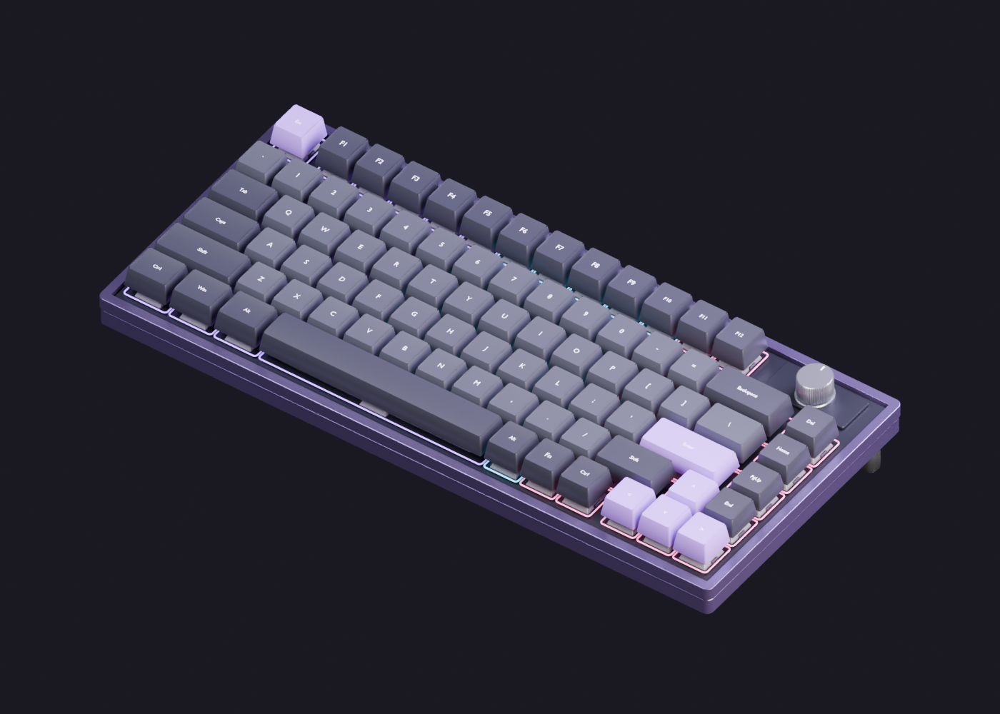

# KlayKey customer storefront

An Express + MySQL mechanical-keyboard shop with a vanilla HTML/CSS/JavaScript frontend and the existing Blender/Three.js asset project integrated as a protected builder. Start with [START_HERE.md](START_HERE.md).

## Customer experience

- Home with original keyboard renders, category navigation and interactive synthesized switch sounds.
- Shop and Parts with database search, category/layout/switch/connection/price/availability filters, sorting and pagination.
- Product detail, stock-aware quantity controls, specifications and related products.
- Register, sign in, sign out, profile and default shipping address.
- Protected 3D custom builder, live server quotes, named saved builds, reopening, duplication and deletion.
- Persistent mixed cart for prebuilt keyboards, individual parts and custom builds; edit custom configurations from the cart.
- Validated simulated checkout, immutable order confirmation and customer order history.
- About, contact, FAQ, privacy, terms and a real 404 response.

The original `keyboard-3d` generator, exports, manifests, audio synthesis and validation tooling are retained. The storefront adds a same-origin iframe bridge and embedded layout styles. ANSI 60%, 75% and 100% models, case finishes, keycaps/materials, switch profiles, RGB, connection modes, knob/display modules, orbit controls and physical-key typing remain in the existing viewer.

## Backend and data

`server/routes/api.js` exposes customer APIs backed by the services in `server/services`. Prepared SQL statements and server-calculated prices prevent trusting browser totals. Build validation uses both the shared compatibility manifest and database component metadata.

MySQL stores users, categories, products, custom builds, carts/items, orders/items, simulated payments, contact messages and sessions. Checkout locks inventory in a transaction, verifies aggregated component stock, stores order snapshots, decrements inventory and clears the cart only on success. Per-user idempotency keys prevent duplicate orders on retry. Existing orders retain their original prices and configuration.

Passwords use bcrypt; sessions regenerate on login/registration and use HTTP-only SameSite cookies. State-changing APIs require CSRF tokens and reject foreign origins. Protected records enforce customer ownership. Users have a role field, but no admin dashboard or unfinished admin navigation is exposed.

## Commands

From this project directory:

```powershell
npm ci
npm run db:local
npm run db:migrate
npm run db:seed
npm run dev
```

Open http://localhost:3000. On this prepared Windows workspace, double-click `start-site.bat` instead. `start-site.ps1 -NoBrowser` starts the same application without opening a browser.

The optional isolated MySQL helper creates `klaykeys_dev` on port 3308 using the installed MySQL 8 executable. For an existing database, configure `.env` from `.env.example` and omit `db:local`. Never commit `.env` or `.local-mysql`.

```powershell
npm test
npm run test:assets
npm --prefix keyboard-3d run validate
```

Commerce tests require a non-production database ending in `_dev`. Run them with no concurrent shoppers: they temporarily adjust test inventory and restore the catalog snapshot. They remove their own account/order fixtures. Browser demonstration records are separate and remain local.

Migrations and seeds are repeatable. Seeds preserve existing products rather than overwriting live stock or prices. A destructive development-only reset exists for deliberate manual use:

```powershell
npm run db:reset -- --confirm-development-reset
```

This permanently deletes the named application's tables/data; it is not a normal startup step.

## Structure

```text
Keyboard E-Commerce/
  public/
    index.html
    css/                   shared and page styles
    js/                    routing, components, customer pages
    assets/images/         optimized renders and original SVGs
  server/
    app.js, server.js, config.js, validators.js
    routes/api.js
    middleware/security.js
    services/              catalog, builds, cart, orders
    database/
      connection.js, setup.js
      migrations/001_store.sql
      seeds/catalog.js
  scripts/                 isolated MySQL and image helpers
  tests/store.test.js
  keyboard-3d/              retained Blender/Three.js project
  .env.example
  package.json, package-lock.json
  start-site.bat, start-site.ps1
  START_HERE.md, README.md, VALIDATION.md
```

## Deliberate limits

This is a publicly hosted academic commerce demonstration. Card and GCash choices create simulated payment records; no card credentials are collected and no provider is called. COD remains pending. Shipping, warranty and returns copy explicitly describes demo behavior. Contact messages stay in the database; email, password recovery, shipping integrations, real payments and an administrator UI are not implemented. Component illustrations are placeholders for future product photography. WebGL and audio require browser support and audio requires a user gesture. Railway provides the deployed HTTPS endpoint; backup retention and operational monitoring need an operator policy before commercial use.

## Production deployment

Public repository: https://github.com/Zackarie08/KlayKey (branch `main`). Live website: https://klaykey-web-production.up.railway.app. See DEPLOYMENT.md for configuration and verification.



The runtime is one Express service, `klaykey-web`, and one dedicated private MySQL service, `klaykey-mysql`. Docker installs locked production dependencies, includes the GLB files and Three.js runtime, and excludes Blender sources/tools from its final image. The repository retains editable Blender sources; see [asset generation instructions](keyboard-3d/README.md).

Production command: `npm start`. Startup binds to `0.0.0.0:$PORT`, applies checksum-tracked ordered migrations, optionally seeds the catalog with `SEED_ON_START=true`, removes expired sessions and then starts HTTP. SIGTERM drains requests. A migration failure prevents startup. Health routes are `/api/health` and `/api/health/ready`. See [DEPLOYMENT.md](DEPLOYMENT.md) for configuration and service isolation.

Set `APP_NAME` to rename the visible storefront; it is supplied by the backend to both the HTML title and frontend session configuration. Cookie identity, database naming and repository naming are independent of the visible brand. The original asset lab uses the neutral title “Keyboard”.

The schema uses exact integer centavos instead of floating-point pesos; JSON address/images/compatibility/build snapshots are the existing equivalents of separate address, image, compatibility and custom-component tables. Inventory is stored on products. No administrator or customer accounts are seeded.

All current binaries are below 20 MB, so Git LFS is not required and no LFS pointers are used in the runtime. If future source assets exceed GitHub's file limit, install Git LFS, track only the required binary patterns, and ensure the deployment checkout resolves runtime LFS objects. Do not track node_modules. No project open-source license is granted by publication; third-party dependencies retain their own licenses.

Additional checks:
```powershell
npm run lint
npm run check:secrets
npm run check:assets
```
The secret scan reports filenames and finding categories without printing values. It is a heuristic safeguard, supplemented by review; it is not a claim that arbitrary future secrets will always be detected.
